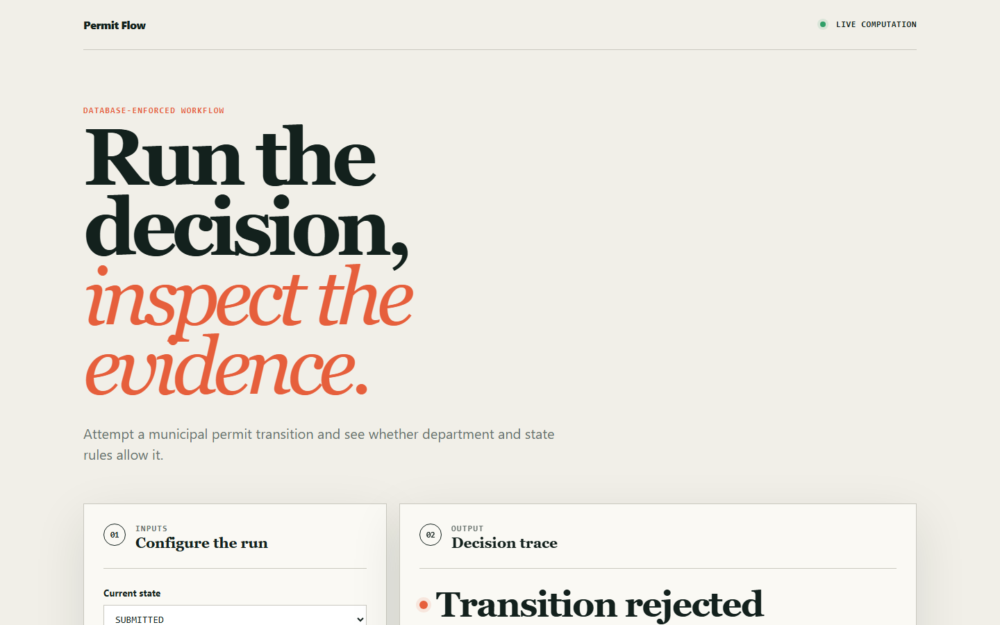
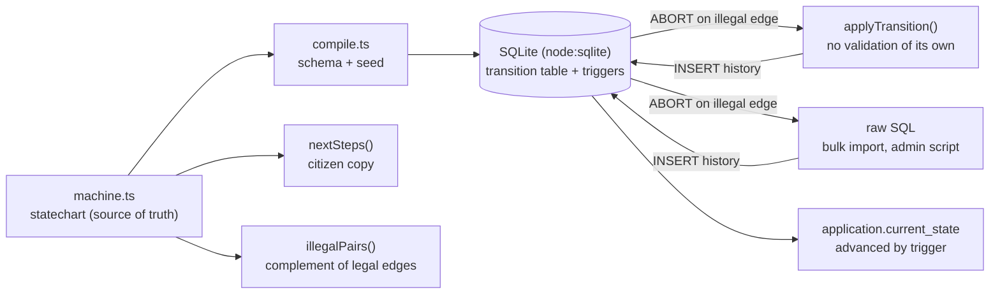

# permitflow

A municipal permit workflow where illegal state transitions are rejected by the database, not by a service layer that some other code path will eventually bypass.

[](https://github.com/Nimisharani/permitflow/actions/workflows/ci.yml)
[Live demo](https://Nimisharani.github.io/permitflow/)



## Why

Permit applications pass through many conditional stages across several departments. When status is a free-text column and the rules live in application code, a bulk import, an admin script or a second service can write straight to the table and leave an application in a state the process says is impossible (issued but never inspected, say). Nobody can then reconstruct how it got there.

permitflow declares the workflow once, compiles it into database objects (a transition table and triggers), and keeps an append-only history. The guarantee is a property of the data store, so a raw `INSERT` that skips the application fails too.

## Features

- A single statechart in `src/machine.ts`: 11 states, 15 declared transitions, each with an acting department, citizen-facing copy and an optional SLA in days.
- `src/compile.ts` turns that declaration into schema SQL: a `transition` table holding the legal edges as data, plus triggers that enforce them.
- Triggers reject an unknown edge, a `from_state` that does not match the application's current state, any move out of a terminal state, and any update or delete of history.
- The application state advances only as a consequence of an accepted history row.
- Citizen "what happens next" text is generated from the same declaration (`nextSteps`), so it cannot drift from the engine.
- A static browser lab in `site/` (deployed to GitHub Pages) for trying department and state combinations.

## Architecture



`applyTransition` deliberately performs no checks and hands the row to the database, so the tests cannot confuse "the database enforces it" with "this function enforces it". The reference target is PostgreSQL; this implementation uses the embedded SQLite in `node:sqlite` so the guarantee is executable with no install. Triggers are the portable part, and the same shape maps to PL/pgSQL.

## Quick start

Prerequisites: Node.js 22.6 or newer (24 recommended; CI uses 24). There are no dependencies and no build step, because TypeScript runs through Node's type stripping.

```bash
git clone https://github.com/Nimisharani/permitflow.git
cd permitflow
npm test        # enforcement suite + site tests
npm run demo    # the walkthrough below
```

## Example

`npm run demo` creates an application, moves it through a legal path, tries a raw-SQL bypass, then sweeps every illegal pair:

```text
  PERMITFLOW - the statechart is compiled into the database
  ----------------------------------------------------------------
  states: 11   declared transitions: 15   illegal pairs: 95

  A normal application:
    DRAFT            -> SUBMITTED            (submit)
    SUBMITTED        -> PLANNING_REVIEW      (assign_planning)
    PLANNING_REVIEW  -> FIRE_REVIEW          (planning_clear)
    FIRE_REVIEW      -> APPROVED             (fire_clear)

  Now a bulk import writes straight to the table, no service layer:
    INSERT INTO history ... VALUES (DRAFT -> ISSUED)
    REJECTED by the database: from_state does not match current state
    state is still: APPROVED

  Swept all 95 illegal pairs: 95 rejected, 0 accepted.
```

## How it works

- **Legal edges as data.** `seedTransitions` writes every `TRANSITIONS` entry into the `transition` table; the `history_transition_must_be_legal` trigger rejects any history row whose `(from_state, to_state, event)` is not in it.
- **No fabricated edges.** `history_from_state_must_be_current` rejects a legal-looking edge claimed from the wrong place.
- **Terminal states are final.** `history_terminal_is_final` blocks anything leaving `ISSUED`, `REJECTED` or `WITHDRAWN`.
- **Append-only audit trail.** `history_no_update` and `history_no_delete` abort rewrites, and each row carries actor, reason and timestamp.
- **State is derived.** `history_advances_application` updates `application.current_state` after an accepted row, so there is no second writer for status.
- **Illegal space.** `illegalPairs()` enumerates every `(from, to)` pair that is not declared (95 of 110 ordered pairs); the suite asserts all of them are rejected.

More detail and trade-offs: [docs/ARCHITECTURE.md](docs/ARCHITECTURE.md).

## Testing

```bash
npm test
```

`tests/enforcement.test.ts` covers:

- a raw-SQL bypass (`DRAFT -> ISSUED`) with no application code in the call stack
- rejection of every illegal pair in the state space
- a legal edge issued from the wrong current state
- terminal states and append-only history, including raw `UPDATE` and `DELETE`
- acceptance of every declared transition, so the gate is not simply denying everything
- agreement between `nextSteps` and the declared outgoing edges

`site/core.test.mjs` checks the browser lab's decision contract. CI runs `node --test`, the site validation script and a Pages deploy from `main`.

## Project layout

```
src/machine.ts          statechart: states, transitions, illegalPairs, nextSteps
src/compile.ts          schema/trigger generation, seeding, application-layer helpers
src/demo.ts             runnable walkthrough
tests/                  enforcement suite
site/                   static browser lab (GitHub Pages)
scripts/                site validation
docs/                   architecture notes and screenshots
```

## Limitations

- The database is in-memory SQLite; there is no persistence layer, HTTP server or UI beyond the lab.
- The browser lab in `site/` uses a simplified transition table of its own (it includes an `INSPECTION` state and differs from `src/machine.ts`); it illustrates the idea and is not generated from the statechart.
- Department queues, SLA-breach reporting and a PostgreSQL migration target are not implemented. `slaDays` is declared in the model but not yet consumed.
- Evolving the statechart while applications are mid-flight is not handled.

## License

MIT, see [LICENSE](LICENSE).

## Maintainer

Originally published at [Nimisharani/permitflow](https://github.com/Nimisharani/permitflow); currently maintained by **Sai Nimisha Kakarla**, Senior Data Analyst. Sai brings 6+ years of analytics experience across retail, healthcare, and supply chain, building trusted insights with SQL, Python, and Tableau.

Contact: [Email](mailto:nimmishareddy@gmail.com) · [LinkedIn](https://www.linkedin.com/in/nimisha-reddy-810a84141)