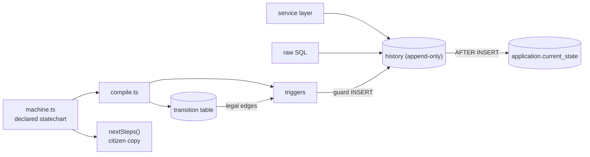

# Architecture

## Context

Permit applications move through several departments. If the rules of that process live only in application code, any other writer (a bulk import, an admin tool, a migration, a second service) can put an application into a state the process forbids, and the history does not explain how. permitflow moves the rules into the database.

## Container view

## Key decisions

**Legal edges are data, rules are triggers.** The statechart compiles to a `transition` table and a small set of triggers. Alternative: a `CHECK` constraint or enum per column. Those cannot express "this edge from the current state", which needs a lookup against the application row. Trade-off: trigger logic is less visible than application code, and has to be tested directly (it is).

**The service layer does not validate.** `applyTransition` forwards the row and lets the database decide. Duplicated checks would make a passing test ambiguous about who enforced the rule.

**State is derived from history.** `current_state` changes only in an `AFTER INSERT` trigger on accepted history, so there is one write path for status. `history_from_state_must_be_current` stops a writer from claiming a legal edge from the wrong place.

**History is append-only.** Update and delete triggers abort, so the audit trail survives an application bug.

**One declaration, several outputs.** The same `TRANSITIONS` array drives the schema, the illegal-pair enumeration used by the tests, and the citizen-facing copy.

**SQLite as the executable target.** `node:sqlite` lets the guarantee run with no install. PostgreSQL is the intended production target; trigger syntax would change but not the design.

## Failure modes

- An illegal write raises an `ABORT` with a specific message (`illegal transition`, `from_state does not match current state`, `application is in a terminal state`, `history is append-only`) and leaves state unchanged.
- Triggers are evaluated in definition order, so an illegal write can be reported by whichever guard fires first. The tests assert rejection, not which guard reported it for the from-state check.
- A schema change that is not regenerated from `machine.ts` would let the table and the code disagree; the seed step reads straight from the declaration to avoid that.

## Out of scope

- Persistence beyond an in-memory database, an HTTP layer and authentication.
- Per-department queue views and SLA-breach alerts (`slaDays` is declared but unused).
- Migrating live records when the statechart changes.
- The static lab in `site/`, which uses its own simplified rules.
